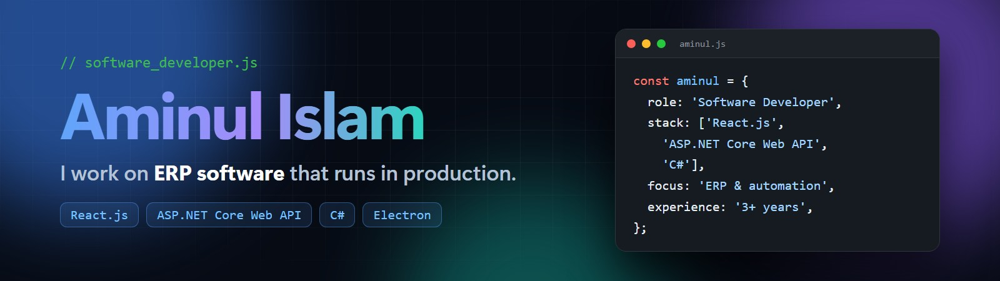
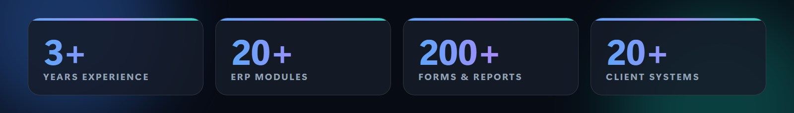
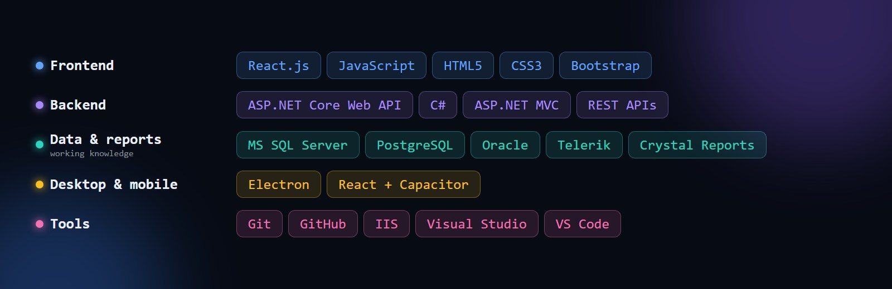
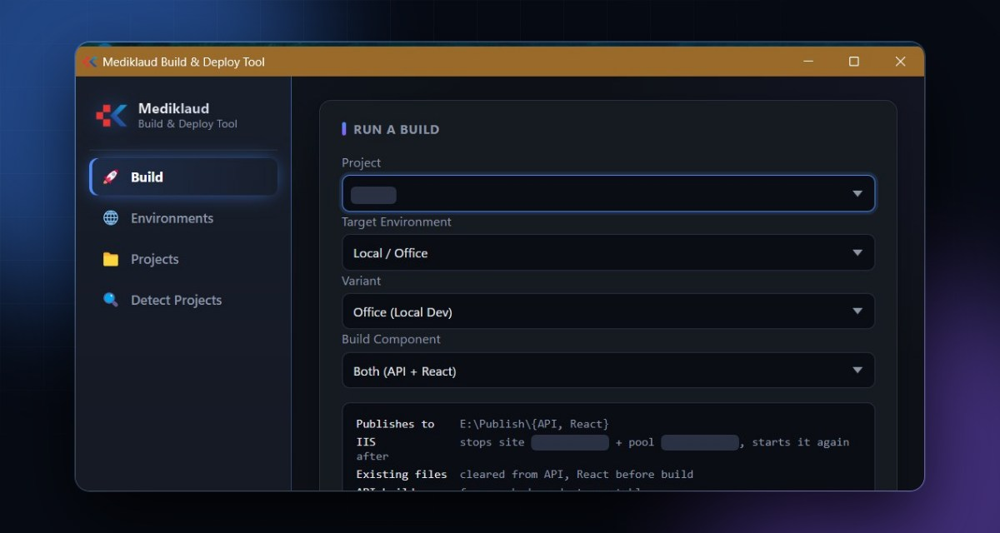

  
  &nbsp;
  

### 👋 About me

Software Developer in **Dhaka, Bangladesh**. I build and ship ERP features with **React.js** and **ASP.NET Core Web API**: forms, reports, APIs and the tooling that gets releases out to client systems.

- 🧩 Contributed to **20+ ERP modules** and **200+ forms and reports** for production clients
- 📱 Independently built the frontend, Android app and backend API of a visitor appointment platform
- 🛠️ Created an Electron tool that automates build and packaging for 20+ client systems

### 🧰 Tech stack

### 🚀 Featured project

<table>
  <tr>
    <td width="52%">
      
    </td>
    <td valign="top">
      <h3><a href="https://github.com/RD-Aminul/MediklaudDeploymentTool">Mediklaud Deployment Tool</a></h3>
      
Electron desktop app that automates build and packaging of ERP releases, replacing manual build and zip steps with a single tool.

      <ul>
        <li><code>git pull</code> → React build → <code>dotnet publish</code> → IIS handling → versioned zip</li>
        <li>Detects project folders and their current Git branch</li>
        <li>Switches environment config before a build and restores it afterward</li>
      </ul>
      
<a href="https://github.com/RD-Aminul/MediklaudDeploymentTool"><b>View repository →</b></a>

    </td>
  </tr>
</table>

More work (appointment platform, ERP modules) on my **[portfolio](https://rd-aminul.github.io)**.

### 📫 Let's connect

Open to interesting conversations. Send me a message through my **[portfolio contact form](https://rd-aminul.github.io/#contact)** or find me on **[LinkedIn](https://www.linkedin.com/in/aminulislam-rb/)**.
